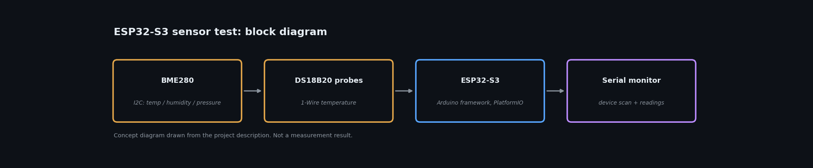

# ESP32-S3 Sensor Test (BME280 + DS18B20)

**Status:** Working code | **Year:** 2026
**Stack:** ESP32-S3, Arduino framework, PlatformIO, I2C, 1-Wire

Combined bring-up sketch for an ESP32-S3 board: reads a BME280 (I2C) and DS18B20 temperature probes (1-Wire), reports found devices, and prints readings over serial for debugging. Built with PlatformIO.

Personal project, not employer or customer work.

*Code, photos and results: added as they are cleaned up.*

