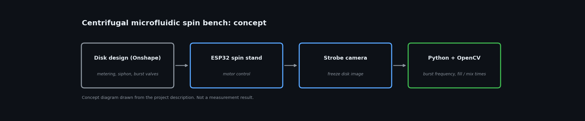

# Centrifugal Microfluidic Disk: Design and Spin-Test Bench

**Status:** Built | **Year:** 2026
**Stack:** Onshape, ESP32, Python, OpenCV

3D-printed / laser-cut PMMA disk with metering chambers, siphon and capillary burst valves (Onshape). ESP32-controlled spin stand with stroboscopic camera. Burst frequencies measured against theory, fill and mixing times from Python/OpenCV image analysis, design FMEA and V&V test plan.

Personal project, not employer or customer work.

*Code, photos and results: added as they are cleaned up.*

