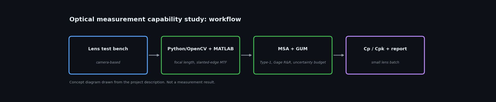

# Optical Measurement Capability Study (Lens Test Bench, MSA, GUM, Cp/Cpk)

**Status:** Built | **Year:** 2026
**Stack:** Python, OpenCV, MATLAB, MSA, GUM

Camera-based lens test bench: focal-length measurement and slanted-edge MTF (ISO 12233 method) in Python/OpenCV and MATLAB. Type-1 study (Cg/Cgk), Gage R&R (ANOVA), GUM uncertainty budget, Cp/Cpk on a small lens batch, automated report and measurement work instruction.

Personal project, not employer or customer work.

*Code, photos and results: added as they are cleaned up.*

